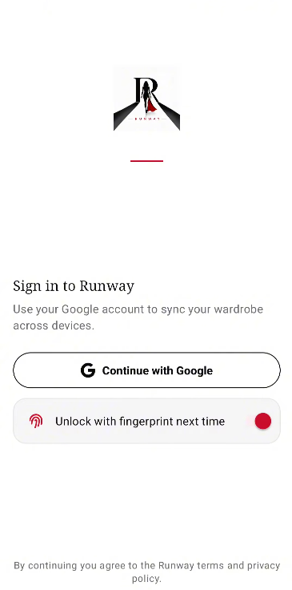
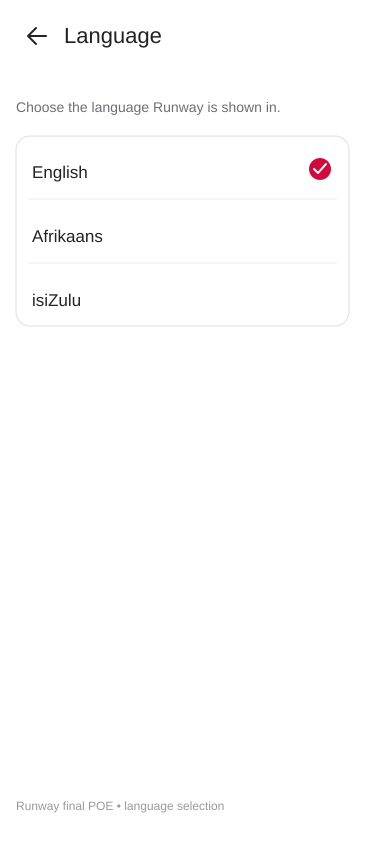
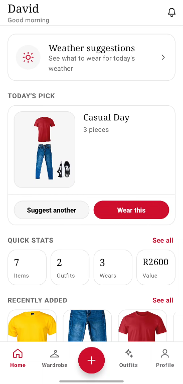
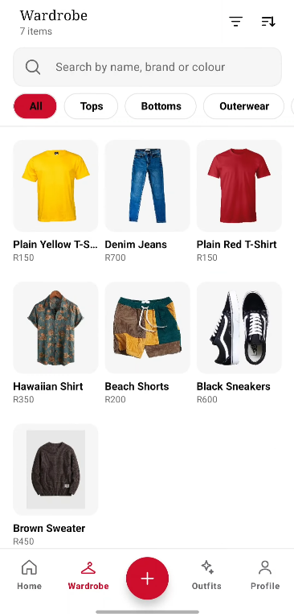
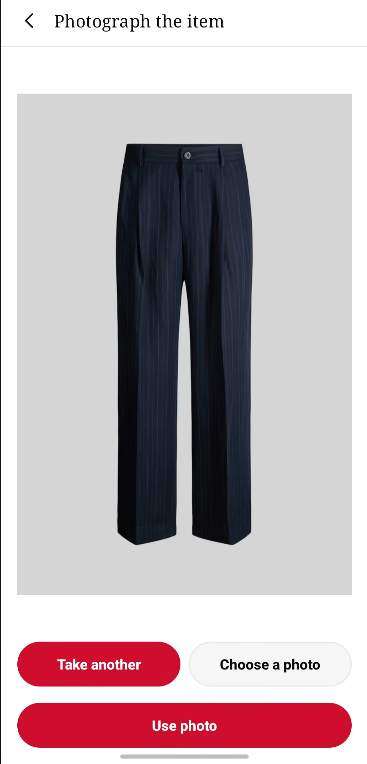
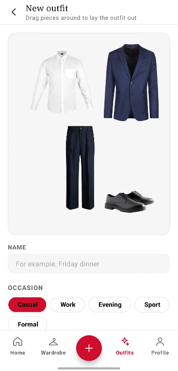
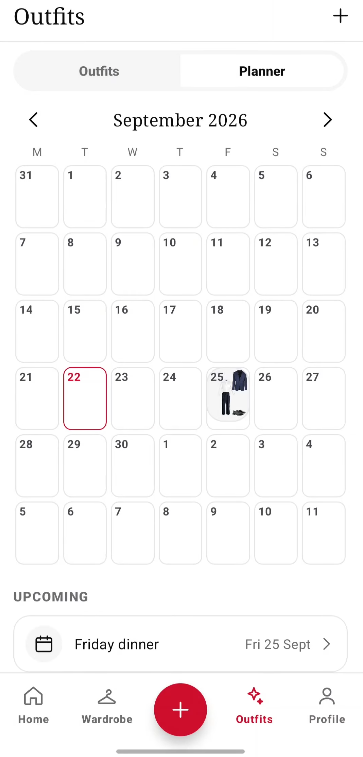
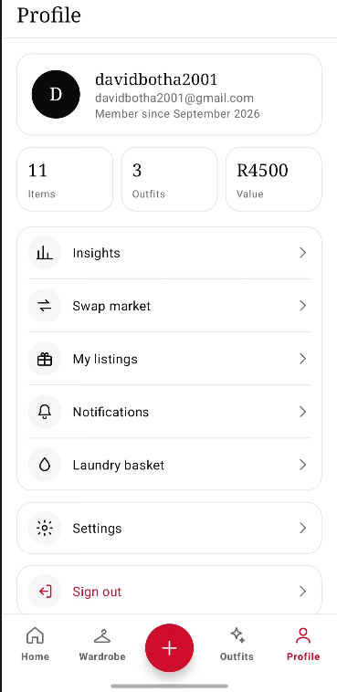
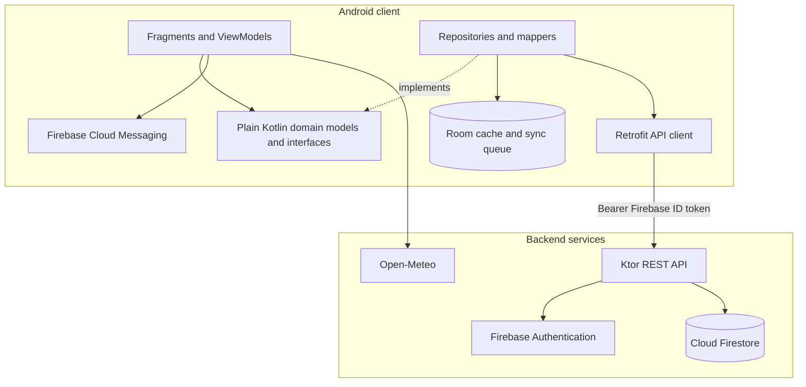

# RUNWAY — Final Technical Report

Runway is an Android digital wardrobe application developed by Group 11 for the PROG7314 POE. It turns photographs of clothing into a searchable wardrobe, supports outfit creation and planning, and helps users make practical decisions using wear history, cost-per-wear, colour matching, weather and notifications.

This repository is the final POE implementation: it extends the Part 1 clickable prototype and the Part 2 working client/API foundation into a tested, authenticated and localised application.

## Final feature set

| Area | Final implementation |
|---|---|
| Authentication | Google Sign-In through Firebase Authentication, persisted sessions and optional biometric unlock |
| Wardrobe | Add clothing with camera/gallery input, on-device ML Kit subject cut-out, metadata tagging, wear logging and cost-per-wear |
| Colour matching | Palette-based matching of compatible items already in the wardrobe |
| Outfit builder | Drag, scale, rotate and layer garments on a canvas; save and view outfits |
| Planner | Month-based outfit planning with day detail and outfit selection |
| Ratings | Confidence rating and rating summary after wearing an outfit |
| Weather | Open-Meteo weather retrieval with rule-based outfit suggestions from the user’s wardrobe |
| Notifications | Firebase Cloud Messaging, notification inbox, Android channels, permission handling, test notification flow and token cleanup |
| Settings and languages | Theme, biometric preference, notification preferences, and English, Afrikaans or isiZulu selection persisted through app settings |
| Offline support | Local Room cache and queued wardrobe changes, with sync status shown in the app |
| API | Ktor REST API with Firebase token verification, Firestore persistence, ownership checks, validation, error handling and OpenAPI/Swagger documentation |

## Screens and evidence

The final UI evidence is stored in [`docs/screenshots`](docs/screenshots/). The Google sign-in screen includes the Google action and optional fingerprint setting. The language picker shows the three supported languages and the selected-language indicator.

### Google sign-in



### Language selection



### Core application screens








The final demonstration video link will be added here when the submission recording is available.

## Technical architecture

The repository contains two independent Gradle builds:

```text
runway/
├── app/    Android client
└── api/    Ktor REST API
```



The Android client uses MVVM and unidirectional state flow. ViewModels expose immutable `StateFlow` UI state, the domain layer has no Android or Room dependencies, and `AppContainer` provides manual dependency injection. The wardrobe repository is offline-first; outfits, plans and ratings use the API directly because those actions are less suitable for silent queuing.

The API verifies the Firebase token on protected routes and scopes every record to the authenticated user. Missing or foreign records are not disclosed through ownership-sensitive responses. Input validation and a consistent JSON error shape are applied at the server boundary.

## Technology stack

| Concern | Technology |
|---|---|
| Client language | Kotlin 2.3.10 |
| UI | Android View System, XML, Material 3 and ViewBinding |
| Architecture | MVVM, repositories and unidirectional `StateFlow` |
| Local persistence | Room 2.8.4 with KSP |
| Navigation | Android Navigation Component, single activity and XML graph |
| Authentication | Firebase Auth and Google Identity Services |
| Backend | Kotlin/JVM, Ktor 3.5.2 and Netty |
| Cloud data | Cloud Firestore and Firebase Admin SDK |
| Networking | Retrofit, Kotlin serialization and OkHttp |
| Device intelligence | ML Kit subject segmentation |
| Weather | Open-Meteo |
| Notifications | Firebase Cloud Messaging |
| Toolchain | AGP 9.3.2, Gradle 9.5, JDK 21, Android compile SDK 37, minimum SDK 26 |

## API surface

The API is documented by `api/src/main/resources/openapi/documentation.yaml` and exposes health, user/settings, wardrobe, outfits, outfit plans, ratings and notification endpoints. Start the server locally and open `/swagger` for the interactive documentation.

Notification endpoints include:

| Endpoint | Purpose |
|---|---|
| `PUT /api/v1/users/me/device-token` | Register the current device for push notifications |
| `DELETE /api/v1/users/me/device-token` | Remove the current device on sign-out |
| `POST /api/v1/notifications/test` | Send a test notification to the caller’s registered devices |

## Building and running

### Option 1: install the release APK

For the quickest evaluation, install `release/Runway-1.0.apk` on an Android phone and open the app. The release build uses the hosted Render API by default, so no local server setup is required.

### Option 2: run from source

Install JDK 21 and Android Studio with an Android SDK, then open the repository root, allow Gradle to sync, and press **Run** on an API 26+ emulator or connected Android phone. `app/google-services.json` is already included in the repository, and the shared debug keystore is configured for the project.

The app targets the hosted API by default:

```kotlin
val useHostedApi = true
```

Leave this as `true` for normal evaluation. Use `false` only when developing against an API running on this PC; the emulator then targets `http://10.0.2.2:8080/`.

### Option 3: run the API locally (optional)

This is only needed for backend development or API testing. Provide `api/serviceAccountKey.json` locally, then run:

```powershell
cd api
.\run-api.ps1
```

Confirm that `http://localhost:8080/health` responds, then use `http://localhost:8080/swagger` to inspect the API. Set `useHostedApi` to `false` in the app before running the client against this local server.

## Verification and testing

The project includes JVM unit tests for domain rules, mappers, repositories, authentication, notification rules and ViewModels, plus Ktor server tests for protected routes and notification behavior.

```powershell
./gradlew :app:testDebugUnitTest
cd api
./gradlew test
```

The test source is under `app/src/test` and `api/src/test`. The notification manual verification plan is in [`docs/notifications-testing.md`](docs/notifications-testing.md).

## Part 1 → Part 2 → Final POE

| Stage | Outcome |
|---|---|
| Part 1 — prototype | Established the Runway brand, navigation model, component language and clickable user journeys |
| Part 2 — working foundation | Implemented the Android client, Ktor API, Firebase authentication, wardrobe persistence, outfit workflows, planning, ratings, offline wardrobe sync and automated tests |
| Final POE | Completed weather suggestions, multi-language support, biometric authentication, settings, FCM notifications, validation, item editing and final documentation/evidence |

The formal release history is in [`RELEASE-NOTES.md`](RELEASE-NOTES.md).

```
SCRUM-134 splash screen
SCRUM-136, SCRUM-140
```

`app/google-services.json` and the shared debug keystore are committed on purpose: the project will not build without the first, and a debug keystore is not a secret, so a fresh clone signs with a certificate Firebase already knows. The signed production APK (`release/Runway-1.0.apk`) is committed so the lecturer can install the app. The release keystore that signs it is shared privately within the team and never committed, along with the Firebase Admin key (`api/serviceAccountKey.json`), `keystore.properties`, `local.properties` and other build output.

## Continuous integration

GitHub Actions builds and tests the project on every push to any branch and on every pull request into `main` (SCRUM-147). The workflow is [`.github/workflows/android-ci.yml`](.github/workflows/android-ci.yml) and has two jobs that run side by side on Ubuntu with JDK 21:

| Job | What it runs |
|---|---|
| Build app and run unit tests | `./gradlew :app:testDebugUnitTest`, then `./gradlew :app:assembleDebug` |
| Run API tests | `cd api && ./gradlew test` |

Work was developed through feature branches and reviewed merges. Sensitive runtime credentials, local properties, release keys and build output are excluded from version control. The Firebase Admin service-account key is required locally but is intentionally not included in this repository.

## AI declaration

Generative AI was used only as a supporting aid for documentation structure, comment consistency, debugging second opinions and cleanup review. No feature was accepted without developer review and verification. See [`AI-REPORT.md`](AI-REPORT.md).

## Team

Group 11, PROG7314.

| Name | Student number |
|---|---|
| Cherubim Estologa | ST10443277 |
| David Botha | ST10446408 |
| Divan Fourie | ST10434242 |
| Mpho Molefe | ST10317078 |
